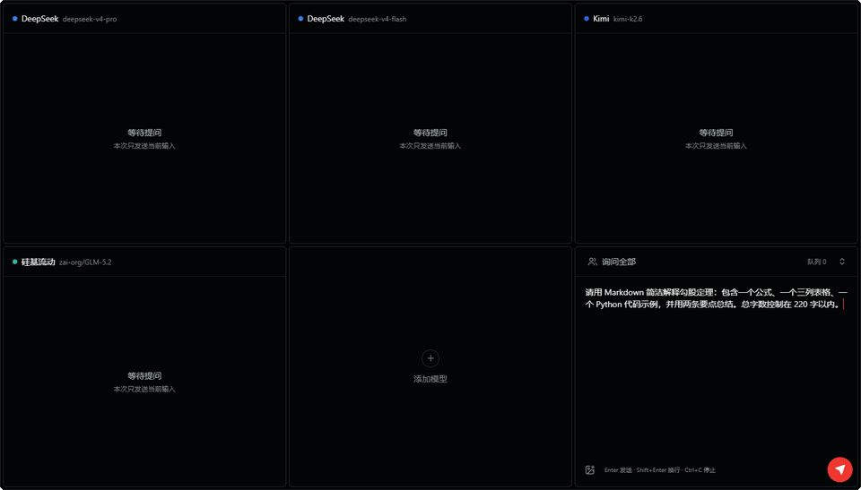
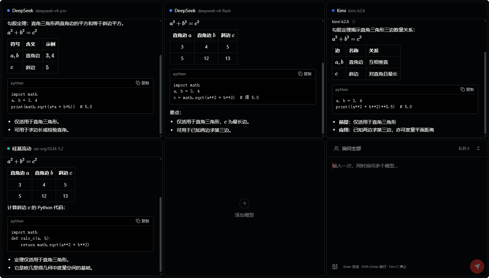
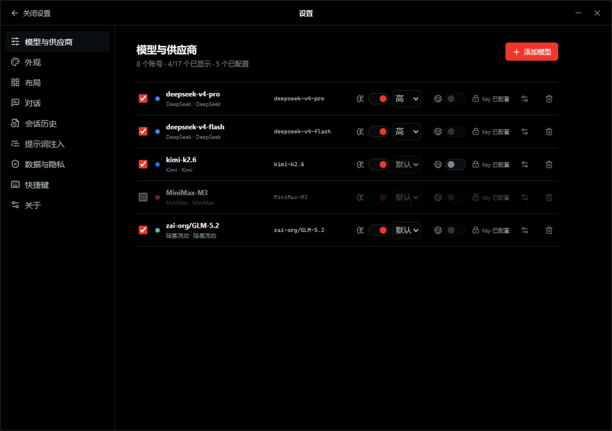
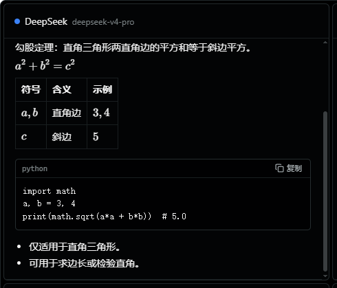
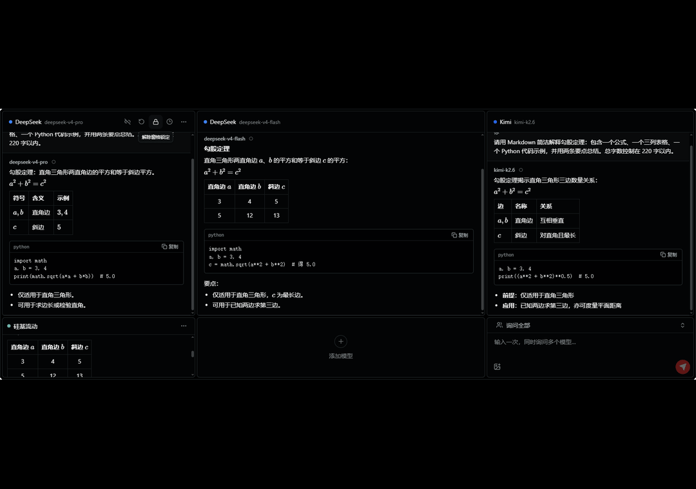
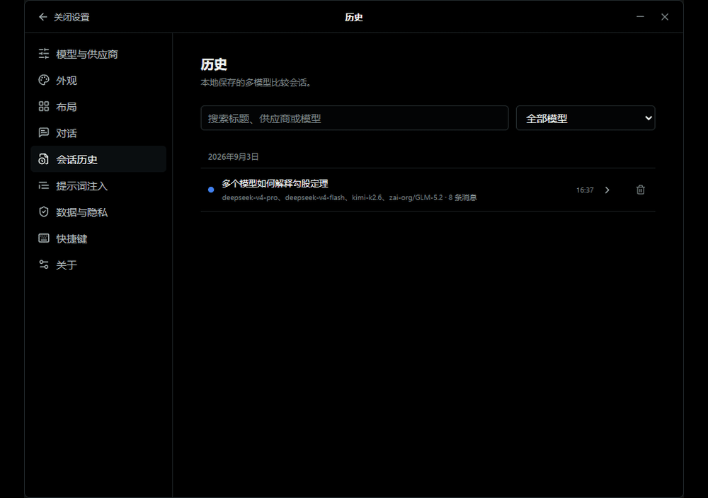
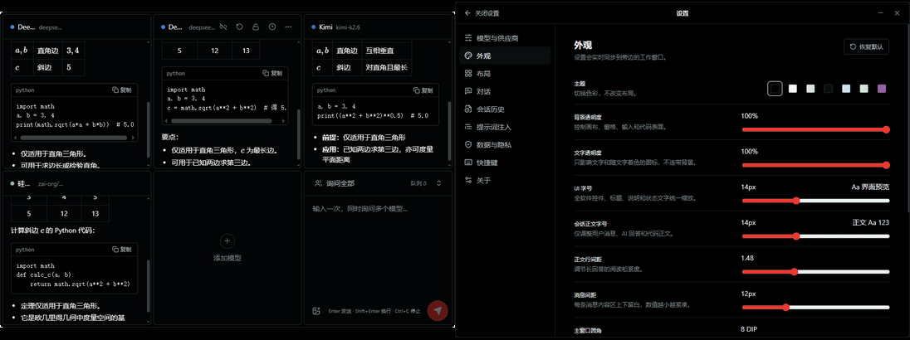

<p align="center">
  
</p>

<h1 align="center">AiPin</h1>

<p align="center">
  一次提问，并排看看不同 AI 会怎样回答。
</p>

<p align="center">
  <a href="https://github.com/JananZZZ/AiPin/actions/workflows/ci.yml"></a>
  <a href="https://github.com/JananZZZ/AiPin/releases/tag/v1.0.0"></a>
  
  <a href="LICENSE"></a>
</p>

<p align="center">
  
</p>

> 上述动图及本文截图均从真实 `AiPin.exe` 的 Tauri/WebView2 窗口采集，不是浏览器版界面。演示使用无隐私问题，采集完成后会恢复本机原有快照。

AiPin 是一个本地优先的 Windows 多模型对比客户端。它把统一输入框、多个独立模型线程和紧凑的可缩放工作区放进一个窗口：你输入一次，AiPin 就能把同一问题并发发送给选中的模型，让差异自然地出现在眼前。

它没有 AiPin 云端账号，也没有中转服务器。API Key 保存在 Windows Credential Manager；会话、布局和附件留在你的电脑上。AiPin 负责组织请求与结果，模型服务仍由你自己选择和管理。

> [!IMPORTANT]
> `v1.0.0` 是 AiPin 的首个正式版本。目前只支持 Windows 10 22H2 / Windows 11 x64，并需要 Microsoft Edge WebView2 Runtime。发布的 EXE 尚未进行 Authenticode 签名，Windows 可能显示 SmartScreen 提示。

## 目录

- [快速开始](#快速开始)
- [它适合做什么](#它适合做什么)
- [主要功能](#主要功能)
- [模型与供应商](#模型与供应商)
- [消息、格式与图片](#消息格式与图片)
- [布局与窗口](#布局与窗口)
- [会话、队列与上下文](#会话队列与上下文)
- [外观与可访问性](#外观与可访问性)
- [数据与隐私](#数据与隐私)
- [快捷键](#快捷键)
- [从源码运行](#从源码运行)
- [项目结构](#项目结构)
- [技术架构与二次开发](#技术架构与二次开发)
- [当前边界](#当前边界)
- [参与项目](#参与项目)
- [许可证](#许可证)

## 快速开始

### 1. 下载

从 [AiPin v1.0 Release](https://github.com/JananZZZ/AiPin/releases/tag/v1.0.0) 下载单文件 `AiPin.exe`。不需要安装，把它放在合适的位置后直接运行即可。

设置、数据库和附件保存在 `%LOCALAPPDATA%\AiPin`，因此替换 EXE 不会自动删除已有内容。API Key 单独保存在 Windows Credential Manager，不跟随 EXE 或 `.aipin` 文件移动。

### 2. 添加模型

点击空模型位，或从顶部控制轨进入“设置 → 模型与供应商”。选择供应商，填写账号别名、Base URL、模型 ID 与 API Key，然后先执行不生成文本的连接测试。

保存模型后，勾选模型行左侧的工作区复选框。只有被勾选的模型会出现在主工作区中，最多同时显示 17 个。

### 3. 开始比较

在输入窗中输入问题，确认目标模型后按 `Enter`。如果上一批请求还没有结束，新问题会按照队列策略进入等待；你可以单独停止某个模型，也可以停止当前整批请求。

<p align="center">
  
</p>

## 它适合做什么

- 比较不同模型对同一问题的理解、写作风格和准确度。
- 同时查看通用模型与推理模型的响应速度和推理路径。
- 为提示词、代码问题、数学问题或长文写作挑选更合适的模型。
- 在一个置顶、透明、可压缩的窗口里持续观察多个生成任务。
- 保留每个模型独立的上下文，不让一个模型的回答混入另一个模型。

AiPin 更像一张安静的工作台，而不是把所有功能堆到眼前的聊天网站。低频按钮会在需要时出现，正文和模型差异始终是画面的主体。

## 主要功能

| 能力 | 说明 |
| --- | --- |
| 多模型并发 | 一次输入，向全部或临时选中的模型并发发送 |
| 独立线程 | 每个模型保存自己的消息、上下文、滚动位置与请求状态 |
| 流式显示 | 支持正文与推理内容的增量输出、停止和局部错误 |
| 智能布局 | 从 1 个模型到 17 个模型，工作区自动扩展到最大 6×3 |
| 自由调整 | 拖动分割线、调整比例、重排窗格、锁定单个窗格 |
| 丰富内容 | GFM Markdown、代码、数学公式和图片输入 |
| 历史与队列 | 多模型比较会话归档、恢复、过滤和 FIFO 队列 |
| 本地优先 | 本地数据库、Credential Manager 密钥、无 AiPin 中转 |
| 可迁移数据 | 配置、会话或完整数据可分别导出为统一 `.aipin` 文件 |

## 模型与供应商

AiPin 提供以下供应商预设，也允许连接自定义的 OpenAI-compatible 服务：

- OpenAI：Responses-compatible。
- DeepSeek、Kimi、MiniMax、GLM、MiMo、硅基流动：Chat Completions-compatible。
- 自定义：Responses-compatible 或 Chat Completions-compatible。

模型 ID 不会被写死为所谓“最新模型”。你可以刷新模型列表，也可以手工填写模型 ID。能力识别采用“用户覆盖 → 主动测试 → 内置预设 → 未知”的顺序；对于没有确认的参数，AiPin 不会凭猜测发送。

<p align="center">
  
</p>

### 思考模式与联网搜索

模型页会根据供应商与模型族展示思考模式、思考强度、预算、输出上限等专属参数。关闭思考并不意味着所有远端模型都一定能够关闭——对于始终思考的模型，界面会说明实际约束。

联网搜索也不是所有模型共有的统一开关。AiPin 只在确认供应商提供对应托管能力时启用，例如 OpenAI Responses、部分 Kimi、GLM 与 MiMo 模型；DeepSeek、MiniMax 和硅基流动的通用 Chat Completions 端点不会被伪装成拥有内置搜索。搜索能力和计费仍以供应商文档为准。

官方文档：[OpenAI](https://platform.openai.com/docs/quickstart) · [DeepSeek](https://api-docs.deepseek.com/zh-cn/) · [Kimi](https://platform.kimi.com/docs/guide/use-thinking-models) · [MiniMax](https://platform.minimaxi.com/docs/api-reference/text-chat-openai) · [GLM](https://docs.bigmodel.cn/cn/guide/develop/openai/introduction) · [MiMo](https://mimo.mi.com/docs/en-US/quick-start/summary/first-api-call) · [硅基流动](https://api-docs.siliconflow.cn/docs/userguide/quickstart)

## 消息、格式与图片

消息不使用聊天气泡。每轮内容通过全宽分区、细分割线、发言人标签和轻微的表面差异区分，方便横向扫读多个模型。

- GFM 标题、列表、表格、引用、任务列表与链接。
- 行内和块级 LaTeX 数学公式。
- AsciiMath、常见 Unicode 纯文本公式与安全 MathML 的规范化转换。
- 代码块、复制和横向滚动。
- PNG、JPEG、WebP 图片的粘贴、拖放和选择。
- 推理内容折叠显示，不与正式回答或其他模型上下文混合。

<p align="center">
  
</p>

原始 HTML、iframe、远程脚本和脚本协议不会执行。外部链接交给系统浏览器打开，AI 输出中的远程图片不会自动加载。

## 布局与窗口

工作区最小可以只有“1 个模型 + 1 个输入窗”，最大为“17 个模型 + 1 个输入窗”。自动模式会根据勾选的模型数选择接近阅读习惯的布局，同时保持输入窗在最后一个位置。

<p align="center">
  
</p>

- 主窗口无系统标题栏，可自由拉宽、拉高、压窄或压扁。
- 顶部隐藏控制轨支持拖动主窗口，并提供历史、布局、置顶、锁定、设置和窗口控制。
- 分割线具备透明命中区，拖动时不会显示突兀的灰色抓手。
- 锁定窗格保持当前位置和尺寸，未锁窗格吸收其余变化。
- 输入窗提供紧凑、正常、扩展三态，并与其他窗格共同参与约束求解。
- 每个会话窗会根据实际尺寸切换正常、紧凑和微型密度，但始终保持完整外框。
- 支持置顶、托盘隐藏、单实例、混合 DPI 和紧急可见度恢复。

## 会话、队列与上下文

上下文默认关闭。开启后，每个模型只接收属于自己的成功历史：A 模型的回答不会进入 B 模型的请求。不完整、失败或停止的回答默认不会进入下一轮上下文。

输入窗默认向全部已选模型发送，也可以临时取消某些目标。活动批次没有结束时，新输入进入 FIFO 队列；队列项目会冻结文本、附件和目标集合，但上下文在真正派发时构建。

<p align="center">
  
</p>

- 每个模型可以单独新建会话。
- 全局新建会话可以保留历史或明确永久删除。
- 历史按完整多模型比较会话组织，可按关键词、模型和日期过滤。
- 恢复历史时一并恢复模型线程与当时布局。
- 输入框为空时可使用方向键调取最近 50 条输入。
- 提示词注入可以为每次发送添加可管理的前缀，同时保留工作区中原始问题的显示。

## 外观与可访问性

<p align="center">
  
</p>

- 内置纯黑、纯白、浅灰、深灰、浅蓝、浅绿和自定义主题。
- 背景透明度与文字透明度分开调节。
- UI 字号、会话正文字号、行距与消息间距独立连续调节。
- 主窗口圆角和内部窗格圆角可在 0–30 DIP 范围内独立设置。
- 设置窗口独立显示，外观修改实时同步到工作窗口。
- 支持减少动态、高对比度、键盘操作、可访问名称和 200% DPI。

当背景和文字都被调到完全透明时，可以通过托盘或 `Ctrl + Alt + Space` 恢复可见度。

## 数据与隐私

AiPin 的默认数据目录为 `%LOCALAPPDATA%\AiPin`：

- SQLite 保存设置、模型定义、布局、队列与会话；当前 v1 的主读写路径是数据库中的聚合应用快照，结构化领域表仍在逐步接管。
- 附件按 SHA-256 保存并去重。
- API Key 使用 Windows Credential Manager Generic Credential。
- SQLite 中只保存密钥引用，不保存完整 Key。

设置页支持“软件配置”“会话数据”和“完整数据”三种导出范围。导入会在写入前备份当前快照，队列恢复为暂停状态，不会在换电脑后自动产生请求或费用。所有导出范围都不包含 API Key。

> [!WARNING]
> 会话数据库和附件没有额外的应用级加密，安全性依赖 Windows 用户权限以及 BitLocker 等磁盘加密。请像保护本地文档一样保护 `%LOCALAPPDATA%\AiPin` 和自行导出的 `.aipin` 文件。

## 快捷键

| 操作 | 快捷键 |
| --- | --- |
| 发送 | `Enter` |
| 换行 | `Shift + Enter` |
| 停止当前批次 | `Ctrl + C` 或 `Ctrl + .`（选中文本时保留复制） |
| 打开历史 | `Ctrl + H` |
| 恢复主窗口与可见度 | `Ctrl + Alt + Space` |
| 取消当前拖动或关闭浮层 | `Esc` |
| 调取输入历史 | 输入框为空时 `↑` / `↓` |

## 从源码运行

### 环境

- Windows 10 22H2 或 Windows 11 x64。
- Node.js 20 或更高版本。
- Rust stable，目标 `x86_64-pc-windows-msvc`。
- Visual Studio Build Tools 的 C++ 桌面构建组件。
- Microsoft Edge WebView2 Evergreen Runtime。

### 安装依赖并启动

项目脚本会把 npm、Cargo、Rustup 和构建目录定向到当前项目，减少对系统盘的占用：

```powershell
git clone https://github.com/JananZZZ/AiPin.git
Set-Location AiPin
npm ci
.\scripts\dev.ps1
```

浏览器模式只使用本地演示流，不会发出真实供应商请求：

```powershell
npm run dev
```

### 测试与构建

```powershell
npm test
npm run build
cargo fmt --manifest-path src-tauri\Cargo.toml -- --check
cargo test --manifest-path src-tauri\Cargo.toml
cargo clippy --manifest-path src-tauri\Cargo.toml --all-targets -- -D warnings
.\scripts\build-release.ps1
```

发布脚本生成 `release\AiPin.exe`。Tauri 会把前端资源嵌入二进制，正式目录不需要携带项目 DLL；Windows 系统组件和 WebView2 Runtime 除外。

## 项目结构

```text
AiPin/
├─ src/                    React 界面、状态、布局和内容渲染
├─ src-tauri/              Rust 桌面外壳、网络、数据库和凭据
├─ tests/                  前端逻辑与原生审计测试
├─ scripts/                开发、发布和文档媒体脚本
├─ docs/                   技术架构、Agent 指南和公开素材
├─ PRODUCT.md              产品定位与设计原则
├─ DESIGN.md               视觉与交互规范
└─ AUDIT.md                当前版本验证记录
```

## 技术架构与二次开发

完整的分层架构、请求生命周期、数据库结构、供应商适配规则和二次开发指南位于：

- [AiPin 技术架构、项目理解与 Agent 开发指南](docs/ARCHITECTURE_AND_AGENT_GUIDE.md)

文档末尾附有一段可直接复制给任意编程 Agent 的中文提示词。替换其中的 `<你的开发需求>`，Agent 就能按项目边界阅读源码、制定修改方案并执行验证。

## 当前边界

- 只支持 Windows 10/11 x64，不支持 32 位、ARM64、macOS 或 Linux。
- 没有云同步、AiPin 账号、团队协作和自动更新。
- 不支持语音、视频、PDF、任意脚本插件或任意 REST JSON 模板。
- 不会自动上传崩溃报告或遥测。
- 不提供忽略 TLS 证书错误的选项。
- 供应商兼容层与公开演示已完成多端点真实请求验证；每家供应商的全部模型族、地区、配额与限流错误仍需相应账号持续覆盖。
- 实际模型能力、价格、数据政策与可用地区以供应商最新文档为准。

## 参与项目

如果你发现问题，可以先阅读 [贡献指南](CONTRIBUTING.md)，再提交 [Bug](https://github.com/JananZZZ/AiPin/issues/new?template=bug_report.yml) 或 [功能建议](https://github.com/JananZZZ/AiPin/issues/new?template=feature_request.yml)。

安全问题请不要直接公开细节，请按照 [安全说明](SECURITY.md) 使用 GitHub 的私有漏洞报告渠道。

## 许可证

AiPin 使用 [MIT License](LICENSE) 开源。你可以学习、修改和重新分发代码，也请保留原许可证和版权声明。
