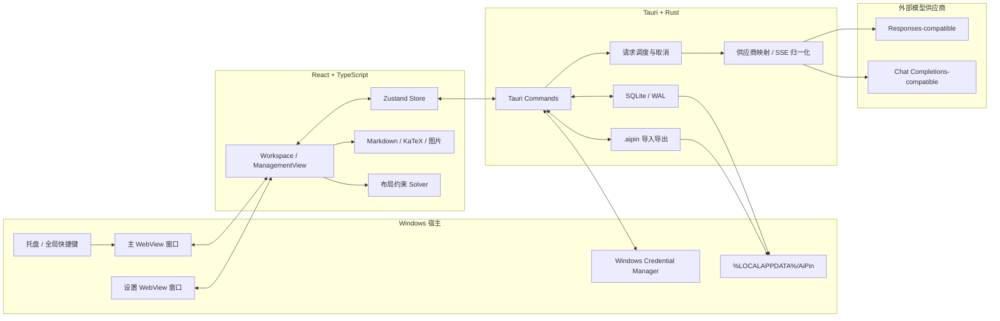
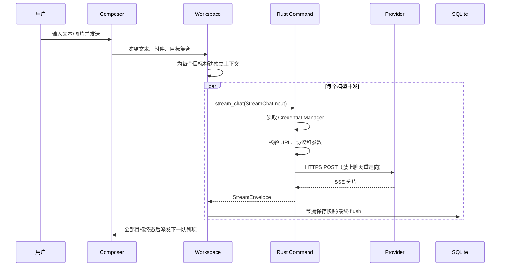
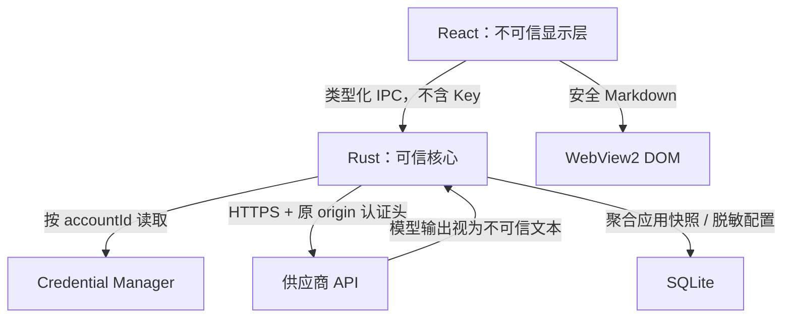

# AiPin 技术架构、项目理解与 Agent 开发指南

本文档解释 AiPin 为什么这样设计、数据怎样流动、哪些边界不能被破坏，以及二次开发时应从哪里开始。它同时面向人类开发者和能够直接阅读仓库的编程 Agent。

## 1. 一句话理解项目

AiPin 是一个 Windows 本地优先的多模型对比客户端：一个输入窗将同一请求发送给多个被选中的模型，每个模型拥有独立线程、上下文、状态和滚动区域，所有结果在一个无边框、可自由缩放的工作区中并排显示。

项目追求的不是“又一个聊天页面”，而是稳定、可解释的模型比较工作台：

- 输入只写一次。
- 请求可以并发，但错误相互隔离。
- 上下文永不跨模型串线。
- 布局可以聪明调整，但锁定行为必须可预测。
- API Key 不能进入 React、SQLite、日志、诊断包或导出包。
- 本地数据去向和供应商请求边界始终能够说明。

## 2. 产品范围

### v1 必须保持的能力

- Windows 10 22H2 / Windows 11 x64。
- 单文件便携 EXE，运行时依赖系统 WebView2。
- 同一工作区最多 17 个模型窗和 1 个输入窗。
- Responses-compatible 与 Chat Completions-compatible 适配。
- SSE 流式正文、推理、完成、失败与取消。
- Markdown、公式、代码、图片输入。
- 独立设置窗口、主题实时同步、托盘、置顶、窗口锁定。
- 本地持久化、会话历史、队列、配置/数据导入导出。

### v1 非目标

- 云同步、AiPin 账号、团队共享。
- 自动更新、后台下载安装。
- 任意脚本、插件、任意 REST 模板。
- 语音、视频、PDF、工具调用平台。
- 鼠标穿透和跨平台桌面支持。
- 将所有供应商强行抽象成完全相同的能力集合。

## 3. 总体架构



### 分层职责

| 层 | 主要职责 | 明确不做 |
| --- | --- | --- |
| React UI | 交互、可视状态、布局、内容渲染、无障碍 | 读取密钥、直接请求供应商 |
| Zustand Store | 工作区快照、线程、队列、设置和浏览器演示状态 | 保存完整密钥、实现 HTTP |
| Tauri IPC | 把经过类型约束的命令交给 Rust，回传流事件 | 允许任意命令或任意文件访问 |
| Rust Core | 网络、取消、持久化、附件、凭据和窗口生命周期 | 把密钥暴露给前端 |
| SQLite | 本地状态、模型元数据、会话和迁移 | 保存 API Key |
| Credential Manager | 每个供应商账号的 Generic Credential | 保存聊天内容 |
| Provider | 接收用户明确发送的模型请求 | 接触其他模型的上下文 |

## 4. 关键目录与入口

```text
src/
├─ App.tsx                         窗口模式、主题变量、快照加载与跨窗同步
├─ store.ts                       Zustand 领域状态与工作区动作
├─ types.ts                       前后端共享概念的 TypeScript 定义
├─ components/
│  ├─ ConversationPane.tsx        单模型窗、状态与消息
│  ├─ ComposerPane.tsx            输入、附件、目标、输入历史和队列
│  ├─ MarkdownMessage.tsx         Markdown/公式/代码安全渲染
│  └─ WindowRail.tsx              顶部控制轨与窗口操作
├─ features/
│  ├─ Workspace.tsx               多窗格编排与批次调度
│  └─ ManagementView.tsx          模型、外观、布局、历史、数据等设置页
└─ lib/
   ├─ layoutSolver.ts             轨道尺寸约束
   ├─ modelParameters.ts          供应商/模型参数能力判断
   ├─ markdown.ts                 多种数学表达规范化
   ├─ providers.ts                供应商预设
   └─ platform.ts                 Tauri 与浏览器演示边界

src-tauri/src/
├─ lib.rs                          Tauri 启动、窗口、命令与附件/便携数据入口
├─ network.rs                      HTTP 客户端、请求映射、SSE 与错误归一化
├─ db.rs                           SQLite、迁移、聚合快照和领域表 schema
├─ credentials.rs                  Windows Credential Manager
├─ security.rs                     URL、重定向和认证安全校验
├─ models.rs                       Rust DTO
└─ main.rs                         桌面程序入口
```

推荐阅读顺序：

1. `README.md`、`PRODUCT.md`、`DESIGN.md`。
2. `src/types.ts` 与 `src/store.ts`。
3. `src/features/Workspace.tsx` 与 `src/components/ComposerPane.tsx`。
4. `src-tauri/src/models.rs`、`network.rs`、`lib.rs`。
5. `db.rs`、`credentials.rs`、`security.rs`。
6. 与需求直接相关的测试。

## 5. 应用与窗口生命周期

AiPin 使用一个进程、两个按需 WebView 窗口：

- `main`：主工作区，透明、无系统标题栏、可置顶、可锁定。
- `settings`：独立设置窗口，默认不置顶，具有自己的最小化和关闭操作。

启动流程：

1. Rust 检查 WebView2 Runtime。
2. 打开 SQLite；迁移失败时停止写入并显示原生错误。
3. 创建 rustls HTTP 客户端。
4. 把 WebView2 用户目录放到 AiPin 本地数据目录。
5. 注册单实例、托盘、窗口状态和 `Ctrl+Alt+Space`。
6. 创建主窗口并加载 React。
7. React 从 Rust 读取持久快照，规范化旧设置后进入工作区。

设置窗口打开时，Rust 保存目标分类和模型编辑路由，再创建或唤醒 `settings`。两个窗口通过 `app-snapshot-updated` 交换不含消息正文的同步快照；设置窗只写配置字段，不能用旧状态覆盖主窗刚产生的会话。

主窗口的关闭按钮默认隐藏到托盘。托盘“退出”才结束进程；存在活动请求时需要明确确认并取消请求。

## 6. 前端状态模型

核心状态位于 Zustand Store：

- `accounts`：供应商账号元数据，不含密钥。
- `profiles`：远端模型 ID、显示名、能力、专属参数和工作区勾选状态。
- `threads`：每个模型的独立消息、上下文、锁定和请求状态。
- `columns / rows / weights`：工作区布局。
- `composerSize`：输入窗紧凑、正常、扩展三态。
- `selectedTargets`：当前发送目标。
- `queue`：被冻结内容的待发送项目。
- `sessionHistory`：完整多模型比较会话快照。
- `promptTemplates`：提示词前缀模板。
- `settings`：主题、透明度、字体、圆角和对话策略。

浏览器开发模式使用 memory/localStorage 演示数据和本地模拟流；只有 Tauri 模式能调用真实 Rust 命令。不要让浏览器预览模式意外发出真实供应商请求。

## 7. AI 请求生命周期



每次请求都有独立的 `requestId`、`attemptId`、`paneId`、`conversationId` 与递增 `sequence`。统一事件类型：

- `started`
- `reasoning_delta`
- `text_delta`
- `usage`
- `completed`
- `failed`

停止单窗只取消该请求的 CancellationToken。停止全部只影响当前批次，不删除后续队列。Chat/Responses POST 不自动重试，避免重复计费；模型列表等幂等读取才允许短退避重试。

## 8. Provider Adapter 与专属参数

AiPin 支持两类线协议：

- Responses-compatible：输入结构、输出事件和托管工具遵循 Responses 风格。
- Chat Completions-compatible：使用 messages 与 SSE delta，但供应商专属字段仍需单独映射。

不能仅因为供应商宣称“OpenAI-compatible”就假设它支持全部字段。新增或修改供应商时：

1. 在 `providers.ts` 定义预设地址、协议、认证和文档。
2. 在 `modelParameters.ts` 根据供应商与模型 ID 识别模型族。
3. 明确思考模式、强度、预算、采样参数和联网搜索支持状态。
4. 在 Rust DTO 与 `network.rs` 中只映射确认支持的字段。
5. 为请求 JSON、能力禁用和边界值补测试。
6. 通过真实账号验证认证、限流、余额不足和畸形 SSE。

联网搜索必须区分“官方托管搜索”和“通用函数调用”。没有接入搜索服务时，不能把函数调用能力描述为已经支持联网。

## 9. 上下文、批次和队列

上下文默认关闭。开启后：

- 每个模型只接收自己的成功历史。
- 未选择该模型的用户轮次不进入它的上下文。
- A 模型回答绝不发送给 B 模型。
- 失败、停止、不完整和跳过的回答默认排除。
- 推理内容只在同一供应商协议明确要求时回传。
- 上下文在队列真正派发时构建，并在请求开始后冻结。

队列项目冻结文本、附件和目标集合。当前批次所有目标进入完成、失败、停止或跳过状态后，自动策略才派发下一项。应用重启后队列统一为暂停状态，不得自行产生费用。

## 10. 布局约束

自动布局根据“活动模型数 + 输入窗”决定网格，最小 2 格，最大 18 格。模型工作区复选框是显示与隐藏的唯一直接入口，配置模型数量可以超过 17，但活动模型最多 17 个。

轨道调整规则：

- 目标轨道先在自身 min/max 内变化。
- 差额由相邻未锁轨道吸收，再向外传播。
- 锁定窗格的尺寸和相对位置不参与分配。
- 无可吸收空间时拖动在可行上限停止。
- 不允许重叠、越界、负尺寸或内部无限画布。
- 主窗口缩小时，锁定约束可以动态提高窗口最小尺寸。

输入窗也是普通布局参与者，只是有紧凑、正常、扩展三档约束。扩展态不能覆盖其他窗格，也不能突破约 50% 工作区上限。

## 11. 内容渲染

稳定消息交给 `MarkdownMessage`：

1. 保护围栏代码和行内代码。
2. 将 AsciiMath、常见 Unicode 公式和安全 MathML 规范化为 LaTeX。
3. 使用 GFM Markdown 解析。
4. 使用严格 rehype sanitize schema 清洗。
5. 使用 KaTeX 渲染公式。
6. 代码和宽公式在内容区内部横向滚动。

流式期间优先轻量更新最后一个内容块，完成后再执行完整 Markdown/公式布局，避免 17 路同时解析造成卡顿。解析失败必须回退原始文本或公式源码，而不是让整条消息消失。

图片进入 Rust 后校验 MIME、文件签名、可解码性、尺寸和大小，再按 SHA-256 原子保存。任何模型拒绝图片时只影响该模型，并提供仅文本重试语义。

## 12. 持久化与便携数据

SQLite 使用外键、WAL 和事务。schema v1 包含：

- 配置：`app_settings`、`provider_accounts`、`model_profiles`、`model_capabilities`。
- 工作区：`workspace_slots`、`layouts`、`pane_constraints`、`window_states`。
- 会话：`comparison_sessions`、`model_threads`、`prompt_batches`、`messages`、`message_content_blocks`。
- 请求与队列：`request_attempts`、`queued_prompts`。
- 附件：`attachments`。

### 当前 alpha 的真实读写路径

`v0.1.0-alpha.1` 的运行时主路径是把完整应用状态序列化为 JSON，并写入 `app_settings` 中的 `app_snapshot_v1`；启动与设置窗口同步也主要从这份聚合快照恢复。上面列出的会话、消息、请求、队列和布局领域表已经进入 schema，但目前不是所有正常操作的主读写来源。它们是后续结构化迁移的目标，不应被描述成已经完整接管持久化。

二次开发时必须先从 `db.rs` 和调用方确认某张表是否真的在当前路径读写，不能只看到建表语句就假设功能已经接入。若把某一领域从 `app_snapshot_v1` 迁移到结构化表，需要同时设计：旧快照读取、一次性回填、写入切换或双写窗口、失败回滚、设置窗同步以及降级保护。迁移完成前不能让快照与领域表互相覆盖造成数据丢失。

迁移必须向前兼容；旧 EXE 遇到更高 schema 版本时拒绝写入。

`.aipin` 是 JSON 容器，格式标识为 `com.aipin.portable`，schemaVersion 当前为 1。范围可选：

- `configuration`
- `data`
- `all`

配置导出会强制把 `secretConfigured` 置为 false 并移除凭据引用。导入配置后，用户必须在新电脑重新填写 Key。附件带 SHA-256 与大小校验，导入上限为 256MiB；导入前保存快照备份，恢复后的队列暂停。

改变便携格式时必须：

- 新增 schema 版本并保留旧版本读取。
- 保证未知字段不会导致危险默认行为。
- 永不加入 Credential Manager 内容。
- 为损坏、超大、非法附件和范围不匹配补测试。

## 13. 安全信任边界



必须保持的规则：

- React 不能读取、重新显示、复制或导出旧 Key。
- 所有真实供应商请求只能由 Rust 发出。
- 远程只允许 HTTPS；HTTP 只允许 localhost、127.0.0.1 和 ::1。
- 聊天 POST 禁止重定向，认证头不得跨 origin。
- 不提供忽略证书错误开关。
- 日志不记录 Key、完整 prompt、回答全文、图片、用户名、文件绝对路径和 URL query。
- AI 输出按不可信输入处理；禁止原始 HTML、iframe、远程脚本和脚本协议。
- 生产版不开放 DevTools，不加载远程代码。
- 诊断包和 `.aipin` 不包含 API Key。

## 14. 常见二次开发入口

| 需求 | 优先检查 |
| --- | --- |
| 新增供应商 | `providers.ts`、`modelParameters.ts`、Rust `network.rs`、DTO 测试 |
| 修改流式显示 | `Workspace.tsx`、`ConversationPane.tsx`、`StreamEnvelope` |
| 修改主题 | `App.tsx` CSS 变量、`app.css`、外观设置页 |
| 修改布局 | `layoutSolver.ts`、Store 轨道动作、`Workspace.tsx` |
| 修改上下文 | Workspace 请求构建、线程消息状态、上下文隔离测试 |
| 修改导入导出 | Rust portable 结构、字段白名单、兼容测试 |
| 新增设置 | `UiSettings`、默认/规范化逻辑、管理页、跨窗同步 |
| 修改窗口行为 | `WindowRail.tsx`、`windowDrag.ts`、Tauri capability、Rust 生命周期 |

## 15. 本地开发与验证

依赖和缓存优先放在项目目录：

```powershell
npm ci
.\scripts\dev.ps1
```

最小验证集合：

```powershell
npm test
npm run build
cargo fmt --manifest-path src-tauri\Cargo.toml -- --check
cargo test --manifest-path src-tauri\Cargo.toml
cargo clippy --manifest-path src-tauri\Cargo.toml --all-targets -- -D warnings
```

涉及窗口、Credential Manager、真实网络、DPI 或托盘时，浏览器测试不能替代 Windows 原生测试。涉及供应商协议时，静态 fixture 不能替代至少一次真实账号验证，但真实测试必须控制费用并清理隔离凭据。

## 16. 容易被破坏的不变量

1. 活动模型最多 17 个，输入窗始终占一格。
2. 所有窗格必须完整位于主窗口内。
3. 锁定窗格不能因为其他窗格调整而漂移。
4. 每个模型只有自己的上下文。
5. 单模型失败不能中止同批其他模型。
6. 发送后输入框立即清空；队列保存被冻结副本。
7. 应用重启不能自动恢复付费请求。
8. 设置窗口不能用旧快照覆盖主窗口消息。
9. API Key 只能存在于输入瞬间、Rust 内存与 Credential Manager。
10. 配置/数据导出永远不包含 API Key。
11. 不支持的模型参数不发送，unknown 不等于 supported。
12. 流式解析失败需要留下已收到内容并标记不完整。

## 17. 可直接复制给编程 Agent 的提示词

将下面内容完整发送给任意能够访问本仓库的编程 Agent，只需替换最后的 `<你的开发需求>`：

```text
你正在维护开源项目 AiPin。它是一个 Windows 10/11 x64 的本地优先多模型对比客户端，技术栈为 Tauri 2、React、TypeScript、Rust、SQLite 和 Windows Credential Manager。

开始工作前，请完整阅读并遵守仓库中的：
1. AGENTS.md
2. README.md
3. docs/ARCHITECTURE_AND_AGENT_GUIDE.md
4. PRODUCT.md
5. DESIGN.md
6. 与本次需求相关的源码和测试

请先基于真实代码确认当前实现，不要只根据需求描述猜测。需要修改时追踪完整调用链：React 组件 → Zustand 状态 → Tauri IPC → Rust 命令/网络/数据库 → 持久化与回传事件。

必须保持以下安全与产品边界：
- API Key 只能由 Rust 写入和读取 Windows Credential Manager，不能进入 React 状态、SQLite、日志、诊断包、截图、测试 fixture 或 .aipin 导出包。
- 所有真实供应商网络请求继续由 Rust 发出；浏览器演示模式不能发出真实 API 请求。
- 不要假设所有 OpenAI-compatible 供应商支持相同参数。先检查供应商和模型族的官方能力，再修改 modelParameters 与 Rust 请求映射；unknown 不等于 supported。
- 联网搜索必须是已接入的官方托管能力，不能把通用函数调用描述成已经支持联网。
- 每个模型的上下文必须独立，绝不能把 A 模型回答发送给 B 模型。
- 单模型失败、停止或限流不能影响同批其他模型。
- 工作区最多 17 个模型窗和 1 个输入窗；窗格不得重叠、越界或丢失完整外框；锁定窗格不得漂移。
- 设置窗口与主窗口需要实时同步，但设置窗口不能用旧状态覆盖主窗口消息、队列或历史。
- 队列在应用重启后必须暂停，不能自动发送和产生费用。
- 修改 SQLite schema 或 .aipin 格式时必须提供向前迁移、旧版本读取策略和损坏输入测试，且永不导出凭据。
- 当前 alpha 主要通过 app_settings.app_snapshot_v1 聚合快照持久化。看到领域表建表语句不代表它已进入主读写路径；修改前先验证真实调用链，迁移时处理回填、双写/切换、回滚与设置窗同步。
- 保留 Markdown 严格清洗、HTTPS 限制、禁止聊天重定向、认证头不跨 origin 等安全边界。
- 不覆盖用户已有改动，不执行破坏性 Git 或文件操作。
- 依赖、缓存、临时工具和大型构建目录优先放在项目工作目录，非必要不占用系统盘。

实现要求：
1. 先说明你从代码中确认的现状、问题根因和将影响的子系统。
2. 若需求信息足够，直接制定可执行计划并实施；只有会显著改变产品行为的歧义才询问。
3. 尽量复用现有类型、设计令牌、Provider Adapter 和状态动作，不建立平行实现。
4. UI 保持 AiPin 的极简高密度风格：极细边框、克制圆角、无聊天气泡、无渐变/发光/厚阴影；纯图标按钮必须有可访问名称、快速提示和键盘焦点。
5. 对异常、离线、取消、部分失败、极小窗口、200% DPI、设置双窗同步和长流式会话进行考虑。
6. 修改后至少运行与改动相关的 Vitest/Rust tests，再运行 npm run build、cargo fmt --check 和 cargo clippy --all-targets -- -D warnings。
7. 涉及真实 Windows 窗口、Credential Manager 或供应商协议时，补充相应原生/真实验证；不要把浏览器模拟结果描述成原生验证。
8. 最终报告完成内容、测试结果、未覆盖风险和关键文件，绝不输出或重复任何密钥。

本次开发需求：
<你的开发需求>
```
